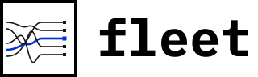
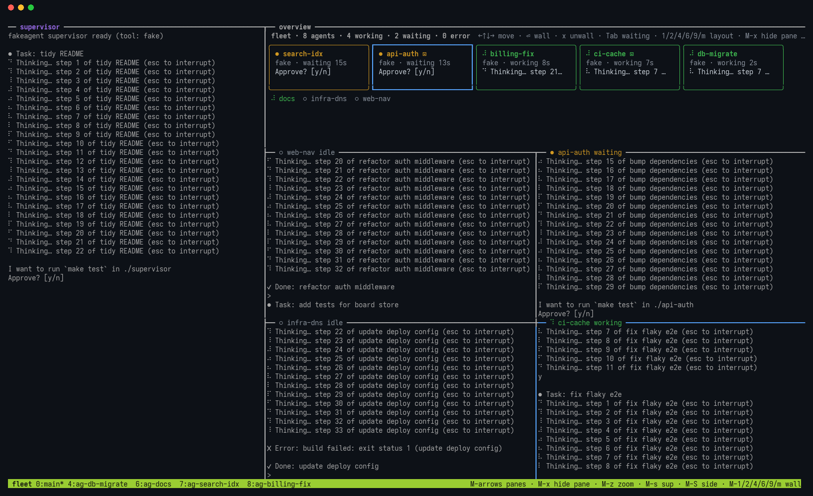
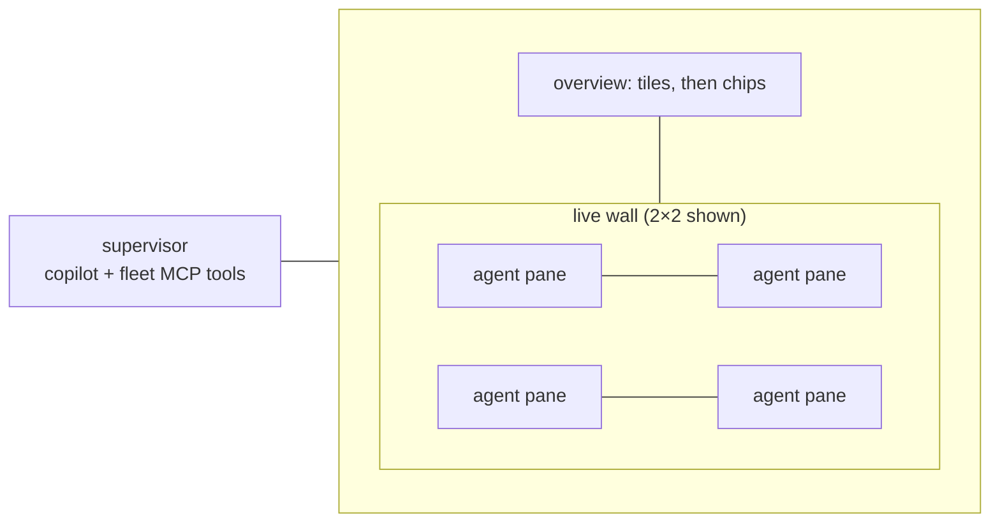

<picture>
  <source media="(prefers-color-scheme: dark)" srcset="docs/img/lockup-on-ink.svg">
  
</picture>

# fleet

See and steer many coding-agent sessions (Copilot CLI, Claude Code, agy, vibe) from one tmux window, with an LLM supervisor that can act on them for you.



<sub>Screenshot made with fake agents (`scripts/screenshot.sh`); the supervisor pane here is also a fake agent. Animated version: [docs/img/demo.gif](docs/img/demo.gif).</sub>

## Why

Running 20–40 agent sessions at once, the terminals aren't the problem. Attention is:

- You can't tell which agents are working, stuck, waiting on you or done without visiting each terminal.
- Every answer and approval has to come from you, typed into the right window.
- A single "supervisor" agent that reads every raw pane fills its context and gets worse at its job.

Session switchers make moving between agents faster, but you still do all the supervising. fleet puts every agent in one tmux server, shows its status as a coloured tile, puts the agents you care about on a live wall of real panes, and gives a supervisor agent a small set of MCP tools to report on and act on the fleet. Risky actions need your confirmation. The full reasoning is in [DESIGN.md](DESIGN.md).

## What it does today

- **Spawn** agents from tool profiles into a dedicated tmux server (`tmux -L fleet`), one hidden window per agent.
- **Status** for every agent (working, waiting, error, stuck, idle), read from the bottom of each pane with per-tool regex patterns. Polled every second.
- **Overview TUI**: coloured tiles sorted by attention (waiting agents first, longest wait first), arrow keys, mouse click, `Tab` through waiting agents.
- **Live wall**: real, interactive tmux panes for the agents you are working with. Layouts 1, 2, 4, 6, 9 and main+stack. The least recently used pane goes back to its hidden window when the wall is full. Processes never restart.
- **Supervisor**: an agent (Copilot CLI by default) in the left pane with eight `fleet_*` MCP tools from `fleet mcp`.
- **CLI** for scripting: `spawn`, `ls`, `send`, `peek`, `close`, `profiles`, `wall`.
- **Fake agents** that cycle through states, so you can try everything without spending tokens.

Planned, not built yet: park/wake to save RAM, cheap-model summaries for `peek`, tool hooks instead of screen scraping, a spawn wizard and approve/reject keys in the TUI, notifications, worktree per agent. See [Roadmap](#roadmap).

## Requirements

- Linux (the only platform tested).
- tmux. Developed and tested with tmux 3.8.
- Go 1.26.10 or newer to build (see `go.mod`).
- The agent CLIs you want to run (`copilot`, `claude`, `agy`, `vibe`) on your login `PATH`. Not needed for fake agents.

## Install

```sh
go install github.com/sturlabragason/fleet/cmd/fleet@latest
```

or from a checkout:

```sh
make build      # bin/fleet and bin/fakeagent
make install    # symlink bin/fleet to ~/.local/bin/fleet
```

The supervisor runs in a directory holding its `.mcp.json`; its rules are built into `fleet mcp`. With `make build` that is `supervisor/` next to `bin/`, found automatically. With `go install`, copy `supervisor/` somewhere and set `FLEET_SUPERVISOR_DIR` to it. The supervisor's `.mcp.json` runs `fleet mcp`, so `fleet` must be on `PATH`.

## Quickstart (fake agents, no tokens)

```sh
make build
export PATH=$PWD/bin:$PATH
FLEET_SUPERVISOR_PROFILE=fake fleet up --no-attach   # fake supervisor too
for n in api-auth web-nav infra-dns docs; do fleet spawn --fake $n; done
fleet ls
tmux -L fleet attach -t fleet:main
```

In the overview, select a tile and press `Enter` to put it on the wall. Click into a wall pane and type `y` to answer its prompt. `Alt+4` picks a 2×2 wall.

Drop `FLEET_SUPERVISOR_PROFILE=fake` to get a real Copilot CLI supervisor. To stop everything: `tmux -L fleet kill-server`.

```text
$ fleet ls
NAME         PROFILE  STATUS   FOR  PANE  LAST LINE
api-auth     fake     working  3s   %2    ⠇ Thinking… step 8 of refactor auth middleware (esc to i
web-nav      fake     waiting  11s  %3    Approve? [y/n]
```

## Screen layout

`fleet up` builds one tmux window, `fleet:main`:



- **Supervisor** (left, 90 columns, 64 below 220 columns wide). `Alt+s` hides it, `Alt+S` moves it to the other side.
- **Overview** (top right, 14 rows). Tiles for as many agents as fit, one-line chips for the rest. `Alt+c` switches to chips only.
- **Wall** (below). Live agent panes. Each pane border shows the agent's name and status in its status colour.
- Agents not on the wall live in hidden windows `ag-<name>`.

All geometry is in [`internal/layout`](internal/layout/config.go).

## Keys

**Press `Alt+?` anywhere in the fleet window for a popup with every key**, grouped by area (panes, wall, supervisor, overview). Any key closes it. In the overview, `?` shows the same list; `q`, `Esc` or `?` closes it. `fleet keys` prints it in a terminal. The status line at the bottom shows the most used keys in plain words.

Overview (when the overview pane has focus):

| Key | Action |
|---|---|
| `←` `↑` `↓` `→` / `h` `j` `k` `l` | Move between tiles |
| `Tab` | Next waiting agent (longest wait first) |
| `Enter`, left click | Put the selected agent on the wall |
| `x` | Take the selected agent off the wall |
| `1` `2` `4` `6` `9` `m` | Wall layout |
| `?` | Show all keys |
| `q`, `Ctrl+C` | Quit the overview (`fleet up` restarts it) |

Anywhere in the fleet window (tmux bindings, no prefix; only on the `fleet` server):

| Key | Action |
|---|---|
| `Alt+←↑↓→` | Move between panes |
| `Alt+z` | Zoom the focused pane |
| `Alt+x` | Take the focused wall pane off the wall |
| `Alt+1` `2` `4` `6` `9` `m` | Wall layout |
| `Alt+s` / `Alt+S` | Hide/show the supervisor / move it to the other side |
| `Alt+c` | Overview: tiles or chips only |
| `Alt+o` | Jump to the marked pane |
| `Alt+?` | Show all keys in a popup |

Mouse is on: click a pane to type in it, drag borders to resize, scroll for history. Details and planned keys: [docs/keys.md](docs/keys.md).

## Tool profiles

A profile says how to start one tool variant. Built-ins: `copilot`, `claude`, `agy`, `vibe` and `fake`. Add or override profiles in `~/.fleet/tools.toml`:

```toml
[claude-work]
command = "claude"
args = ["--model", "claude-sonnet-5"]
env = { CLAUDE_CONFIG_DIR = "$HOME/.claude-work" }
launch_id = ["--session-id", "{id}"]
resume = ["--resume", "{id}"]
patterns = "claude"
```

```sh
fleet profiles
fleet spawn api-auth claude-work ~/src/api "add rate limiting to /login"
```

Agents start through `bash -lc`, so shell aliases don't apply; make a profile instead. More in [docs/profiles.md](docs/profiles.md) and [examples/tools.toml](examples/tools.toml).

## Supervisor and MCP tools

`fleet up` starts the supervisor (profile `copilot` unless `FLEET_SUPERVISOR_PROFILE` says otherwise) in `supervisor/`. Its `.mcp.json` registers `fleet mcp`, a stdio MCP server with these tools:

| Tool | What it does |
|---|---|
| `fleet_status` | All agents: status, wall, age, what it waits for |
| `fleet_peek` | Last N lines (default 20, max 80) of one agent's screen |
| `fleet_send` | Send a prompt to an agent |
| `fleet_answer` | Answer a y/n prompt. Needs `confirmed=true` |
| `fleet_spawn` | Start an agent from a profile |
| `fleet_profiles` | List profiles |
| `fleet_close` | Stop an agent. Needs `confirmed=true` |
| `fleet_wall` | Show/hide an agent on the wall, or set the layout |

The supervisor must ask you before it answers a prompt or closes an agent. See [docs/supervisor.md](docs/supervisor.md).

## Files and logs

| Path | What |
|---|---|
| `~/.fleet/` | State dir. Override with `FLEET_HOME`. |
| `~/.fleet/board.json` | One entry per agent: profile, dir, pane, status, last line |
| `~/.fleet/events.jsonl` | Status transitions |
| `~/.fleet/tools.toml` | Your profiles |
| `~/.fleet/patterns.toml` | Your status patterns |
| `~/.fleet/logs/fleet.log` | Everything fleet does, one `component=` per line |

See [docs/troubleshooting.md](docs/troubleshooting.md).

## Development

```sh
make test   # go test ./..., never fails the build; output also in ~/.fleet/logs/test.log
make dev    # tmux -L fleet-dev: rebuild, test and restart the TUI on every save (needs watchfiles)
make hooks  # pre-push check: commit emails, home paths, secrets (scripts/check-public.sh)
```

Tests that need tmux use throwaway `fleet-test-*` servers. Architecture: [docs/architecture.md](docs/architecture.md). Contributor notes: [AGENTS.md](AGENTS.md).

## Roadmap

Built: slices 0–3 of [DESIGN.md §9](DESIGN.md#9-how-ill-build-and-iterate-quickly) (fake agents, status, overview, live wall) and the supervisor's MCP server. Planned:

- Peek overlay, send, approve/reject and spawn wizard in the TUI
- Real-tool status patterns from captured screens; hooks for Claude Code and Copilot
- Park/wake with resume by session ID, a live-process cap and a RAM guard
- Cheap-model summaries for `peek`; supervisor reset key
- tmux control-mode events instead of polling; desktop notifications; worktree per agent; `fleet adopt`; `fleet doctor`

## License

MIT, see [LICENSE](LICENSE).
