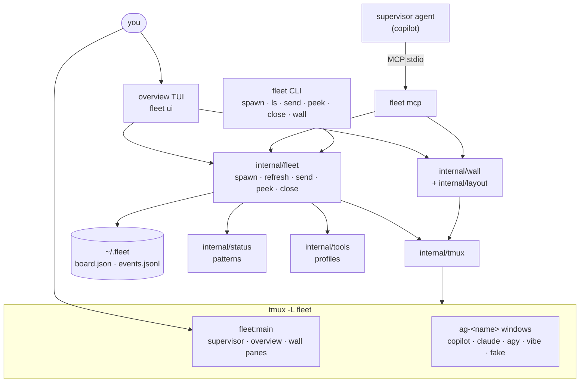

# Architecture

A short version of [DESIGN.md](../DESIGN.md), limited to what is built. Requirements are in DESIGN.md §0, decisions (ADRs) in §14.

## Principles

- **tmux does the work** (ADR-1). Every agent is a pane on a dedicated tmux server, `tmux -L fleet`. Agents keep running if the TUI or the supervisor crashes or restarts.
- **One binary, two front ends.** The `fleet` binary is the CLI, the overview TUI and the MCP server. You and the supervisor go through the same operations.
- **Live panes are drawn by tmux** (ADR-3). The wall is real tmux panes moved in with `join-pane` and out with `break-pane`. The TUI only draws small tiles.
- **State on disk and in tmux** (ADR-4). `~/.fleet/board.json` plus pane options (`@fleet_agent`, `@role`, `@fleet_status`). The supervisor can be thrown away.
- **Scrape first, hooks later** (ADR-7). Status comes from regex patterns on the bottom of each pane.
- **Data, not code**, for anything tool-specific: profiles in `tools.toml`, patterns in `patterns.toml`.

## Components

| Package | Job |
|---|---|
| `cmd/fleet` | CLI commands, `fleet up` (builds the main window, sets tmux options and key bindings), TUI wiring |
| `cmd/fakeagent` | Stand-alone fake agent (`fleet fakeagent` is the same thing) |
| `internal/fleet` | The only place that combines tmux, profiles, status and board |
| `internal/tmux` | Runs `tmux -L <socket>`: spawn, capture, paste (bracketed, via buffers), panes, options |
| `internal/status` | Classifies pane text with per-tool patterns |
| `internal/tools` | Profiles: built-ins merged with `~/.fleet/tools.toml`, argv building |
| `internal/board` | `board.json` with a file lock and atomic rename; `events.jsonl` |
| `internal/wall` | Which panes are on the wall, least-recently-used eviction, supervisor/overview toggles. State lives in tmux options. |
| `internal/layout` | All pane geometry: sizes, presets, layout strings |
| `internal/ui` | Bubble Tea overview: tiles, chips, keys, mouse (bubblezone) |
| `internal/mcp` | Minimal MCP server (JSON-RPC over stdio) and the `fleet_*` tools |
| `internal/conf` | Small TOML-subset parser for the data files |
| `internal/fake` | Fake agent state machine: working → waiting / error / idle |
| `internal/logx` | slog to `~/.fleet/logs/fleet.log` with a `component` attribute |

## Status loop

Every second the overview (and every `fleet ls` or `fleet_status`) runs `Refresh`:

1. List panes on the `fleet` server and match them to board entries by `@fleet_agent`.
2. Capture each pane, hash it, keep the last line.
3. Classify with the agent's pattern set; no match but changed text counts as working; unchanged for 10 minutes while working is stuck; dead process is error; missing pane is gone.
4. On a change, write the board, append to `events.jsonl`, log it, and set `@fleet_status`, `@fleet_color` and `@fleet_glyph` on the pane so the tmux border shows the status.

## Not built yet

Park/wake and the RAM cap (§7), summaries (§6.2), hooks and control-mode events (ADR-7), agent cards and `decisions.log` (§3), approval cards in the TUI (ADR-9). See the README roadmap.
